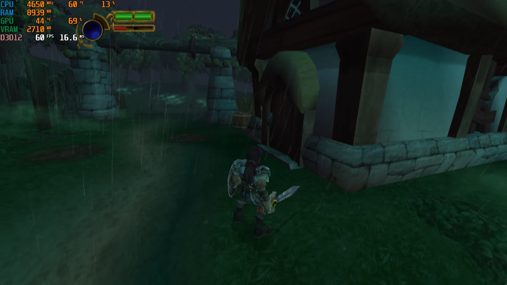
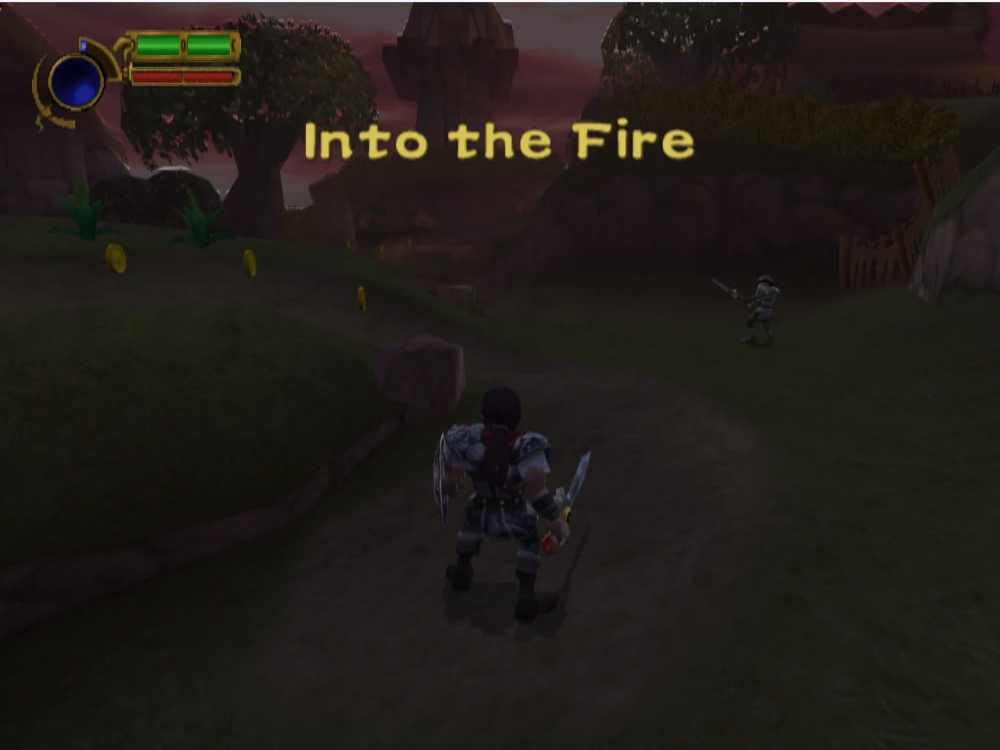

<div align="center">

# 🦖 Maximo Rex
### PS2Native recompilation research for *Maximo vs. Army of Zin*

**Native Windows research build · PAL `SLES_517.59` · Experimental**


A source-only engineering project focused on PS2 execution accuracy, graphics correctness,
performance, reproducibility and widescreen gameplay.

**[Compatibility](#-compatibility) · [Build](#-build-and-test) · [Engineering](#-engineering-history) · [Support](#-support-development)**

</div>

---

## 📸 Gameplay gallery

### Widescreen village gameplay (16:9)



### Level transition — *Into the Fire* (4:3)



*Screenshots captured from local test builds. On-screen FPS/monitor readings are snapshots, not performance guarantees. Game content and trademarks belong to their respective rights holders.*

## ✨ Current highlights

- **VU1 timing fix:** corrects integer-register backup expiration and branch behavior shared by PS2Native's VU1 execution paths.
- **Visible terrain correction:** the large brown polygon observed in the rainy village no longer appears in the validated comparison scenes.
- **Aspect-ratio profiles:** 4:3 and an optional 16:9 profile using a separately supplied widescreen PNACH.
- **Higher internal resolution:** 4× rendering demonstrated in local Direct3D 12 tests.
- **Reproducible research:** source, synthetic regression tests, build scripts and engineering reports are tracked separately from game assets.

> [!IMPORTANT]
> **Experimental source candidate, not a finished game port.** The game is not included. Full-game compatibility, long-term performance, saves and every level have **not** been validated.

## 🎮 Compatibility

| Area | Current evidence | Status |
|:--|:--|:--|
| PAL 4:3 gameplay | Scripted village scenes and local manual gameplay | ✅ Observed |
| Widescreen 16:9 | Scripted village scenes and local manual gameplay | ✅ Observed |
| Terrain/color fix | PCSX2 differential comparisons, including 28 corrected vertex colors and 840 values in 30 packets | ✅ Validated in test scene |
| 4× internal resolution | Fresh D3D12/DXC test captures and local manual test | ✅ Observed |
| Level transitions | One manual 4:3 transition into *Into the Fire* reported; dedicated automated transition check pending | 🟡 Partial |
| Audio | Running; brief buffer underruns observed in a widescreen test log | 🟡 Needs polish |
| Full playthrough, other regions | Not established | ⚪ Untested |
| Performance | 60 FPS observed in manual screenshots; controlled 4:3 headless AOT frame time increased 17.7% in a Stage 4 test | 🟡 Work in progress |

Fresh builds also reproduced 62 frames per aspect ratio using local checkpoints and eight reference captures byte-for-byte. The disc-only 4:3 cold run reached title, new game and the opening cinematic. These tests do **not** establish complete game compatibility.

See [Stage 4 validation](docs/maximo-rex/stage-4-vi-branch-timing.md) and [publication audit](docs/maximo-rex/publication-audit.md).

## 🛠️ Build and test

**Prerequisites:** C++20-capable Clang toolchain, CMake 3.20+, Ninja, Python 3.11+; SDL2 for the desktop window and wgpu-native for the GPU renderer and higher internal resolutions. Node.js supports optional Wasm tests. See [pinned dependencies and licenses](docs/maximo-rex/dependencies.md).

Supply your **own legitimate PAL disc image**. For 16:9, separately supply a compatible PNACH containing the `Widescreen 16:9` section.

```powershell
# Run synthetic VU1 regression checks
python scripts/check_vi_branch.py

# Generate 4:3 native runner from your own PAL disc image
python scripts/build_maximo.py --profile 4x3 --disc "D:\local\maximo-pal.iso"

# Generate optional widescreen runner
python scripts/build_maximo.py --profile 16x9 --disc "D:\local\maximo-pal.iso" --pnach "D:\local\SLES-51759_86E533E0.pnach" --section "Widescreen 16:9"
```

Generated game-specific material stays under ignored local directories. For detailed Windows build and run instructions, read [docs/maximo-rex/build.md](docs/maximo-rex/build.md).

## 🔬 Engineering history

| Stage | Investigation | Result |
|---|---|---|
| [1](docs/maximo-rex/stage-1-renderer-baseline.md) | Renderer and baseline | Reproduced the terrain artifact |
| [2](docs/maximo-rex/stage-2-vertex-color.md) | Vertex-color divergence | Traced the bad color upstream of the GPU |
| [3](docs/maximo-rex/stage-3-vif-vu-timing.md) | DMA1, VIF1 and VU1 timing | Identified VI branch-backup lifetime issue |
| [4](docs/maximo-rex/stage-4-vi-branch-timing.md) | Correct VU1 timing | Fixed branch behavior and validated the terrain scene |

**Code provenance:** [upstream revision and project history](docs/maximo-rex/provenance.md).  
**Current research checkpoint:** `maximo-rex-stage4-candidate-1`.

## ❤️ Support development

Maximo Rex is an independent, unofficial research effort. Contributions help support engineering time, testing, compatibility work and documentation.

| Method | Availability |
|---|---|
| **GitHub Sponsors** — international contributions | Planned; the account must finish Sponsors onboarding before accepting funds |
| **PIX** — donations in Brazil 🇧🇷 | Planned; a public payment link/QR code will be added after setup |

**All donations are optional.** Donations do not buy access to the game, game files, private builds containing copyrighted content, or promised features. The project does not distribute commercial assets. Details: [support setup](docs/maximo-rex/support.md).

## 🙏 Credits and legal notes

- **PS2Native:** [exoteric33](https://github.com/exoteric33/ps2-native-recomp) and contributors.
- **ps2-web-recomp:** [Samir Nuri](https://github.com/snuri00/ps2-web-recomp).
- **PCSX2:** used as an external technical reference for comparative testing; not included in this repository.
- **Maximo vs. Army of Zin:** original game, graphics, audio, characters and trademarks belong to their respective rights holders.

This repository contains source code and authored tests under the [MIT license](LICENSE), with [third-party notices](docs/maximo-rex/dependencies.md). It distributes **no ISO, BIOS, commercial executable, proprietary game assets, generated commercial code, memory card, save or built game runner**. The project is unaffiliated with and is not endorsed by the original game's publishers or developers.
